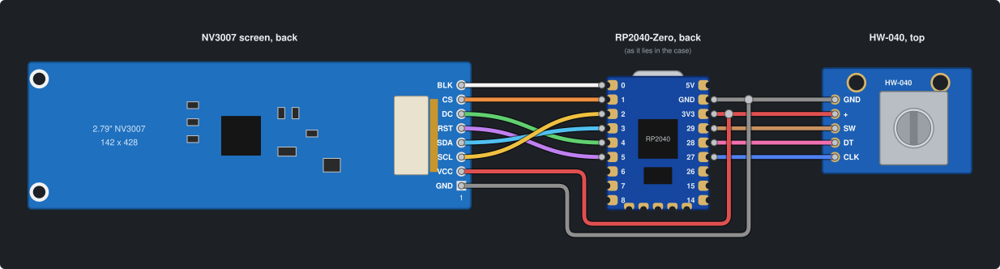

# volume-keeb 🎚️

A desk knob that works as a **per-app volume mixer**. Turn it to change the volume of Spotify, your browser, a game or the whole system. Click to pick an app, hold to mute, double-click to play/pause. A 2.79" bar-shaped LCD shows what's playing.

It's built from cheap parts (a Waveshare RP2040-Zero, an HW-040 rotary encoder and a 2.79" NV3007 LCD) in a 3D-printed case, and runs [QMK](https://qmk.fm). A small host app for Linux and Windows tells the knob which apps are playing, applies what you do on it, and serves a settings page for themes, colors and fonts.

**See the case in 3D: https://joaopedropio.github.io/volume-keeb/**

This README is a step-by-step guide to building your own. If you want to change the firmware, the host app or the case, see [docs/DEVELOPMENT.md](docs/DEVELOPMENT.md).

## Contents

- [Features](#features-)
- [Requirements](#requirements-)
- [Bill of materials](#bill-of-materials-)
- [Tools](#tools-)
- [Step 1: Print the case](#step-1-print-the-case-)
- [Step 2: Download the software](#step-2-download-the-software-)
- [Step 3: Flash the board](#step-3-flash-the-board-)
- [Step 4: Wire it up](#step-4-wire-it-up-)
- [Step 5: Test before closing](#step-5-test-before-closing-)
- [Step 6: Assemble the case](#step-6-assemble-the-case-)
- [Step 7: Set up the computer](#step-7-set-up-the-computer-)
- [Settings page](#settings-page-)
- [Using it](#using-it-)
- [Themes](#themes-)
- [Troubleshooting](#troubleshooting-)
- [Credits](#credits-)

## Features [🔼](#contents)

- **Per-app volume**: every app that is playing sound gets its own entry, plus `Master` for the system's default output.
- **Media info**: the title of what's playing (from MPRIS on Linux, the media overlay's sessions on Windows: Spotify, browsers, most media players) shown large on the screen.
- **Play/pause and mute** from the knob.
- **Themes, colors and fonts from a settings page**: seven preset themes, `neon` (synthwave), `terminal` (green phosphor), `neobrutal` (cream, black and orange, hard shadows), `winamp` (the classic Winamp skin), `studio` (a volume dial), `hifi` (an analog VU meter) and `console` (a mixing desk), any color you like on top, and your own TrueType/OpenType fonts. The page runs on your computer and opens from a tray icon, like Jellyfin's.
- **Screensavers**: after a while without touching the knob (30 s by default), the screen plays one of five animations: a synthwave drive (a car on a road through a striped sea, palm trees going by, a neon city under the stars), a flight through the stars, Matrix-style rain, a plasma in your theme's colors, or what's playing bouncing around. You can turn the screensaver off, and have the screen go dark after a set time. Turning or pressing the knob brings the UI back; that first touch does nothing else. The screen also goes dark while the computer is suspended.
- **Wakes the computer** from suspend.
- **Linux and Windows.**
- **No drivers**: it's a plain USB HID device.

## Requirements [🔼](#contents)

> [!IMPORTANT]
> The app mixer runs on **Linux** with PulseAudio, or PipeWire with `pipewire-pulse` (the default on Ubuntu, Fedora, Arch and most current distros), plus systemd; and on **Windows 10/11**. macOS isn't supported yet.

You also need:

- Access to a 3D printer (or a printing service).
- A soldering iron. There are no connectors or pin headers: every wire is soldered straight to the pads.

You don't need to compile anything: the firmware and the Windows app come ready-made from the [releases page](https://github.com/joaopedropio/volume-keeb/releases/latest).

## Bill of materials [🔼](#contents)

| Part | Qty | Notes |
|---|---|---|
| Waveshare **RP2040-Zero** | 1 | The version **without** pin headers. Clones work if they have the same size and pinout (the case is drawn around Waveshare's board). |
| **HW-040** rotary encoder module | 1 | The 5-pin module (`CLK`, `DT`, `SW`, `+`, `GND`) with a 6 mm shaft. A KY-040 is electrically identical, but the case is only drawn for the HW-040 so far. |
| **2.79" 142x428 NV3007 SPI IPS LCD** module | 1 | 78 x 25.9 mm bar-shaped module, 8 pads (`GND VCC SCL SDA RST DC CS BLK`). Search for "2.79 inch LCD NV3007 142x428". |
| Metal knob, **48 mm diameter, 22 mm tall**, for a 6 mm shaft | 1 | The case's hole is sized for it (`knob_d`/`knob_h` in the `.scad` if yours is different). About 8.5 mm of shaft goes into it, so it needs a bore at least ~9 mm deep. |
| M2 heat-set brass insert, **3 mm long, 3.5 mm outer diameter** | 8 | 4 for the top, 2 for the screen, 2 for the encoder. |
| M2 x 5 pan-head screw | 4 | 2 for the screen, 2 for the encoder. |
| M2 x 6 flat-head (countersunk) screw | 4 | Close the case from below. |
| Thin silicone wire (28–30 AWG) | ~1 m | 13 wires in total. Several colors help a lot. |
| USB-C cable | 1 | Data cable, not charge-only. |
| Printed case: `volume_case-top.stl` + `volume_case-base.stl` | 1 set | See [Step 1](#step-1-print-the-case-). |

## Tools [🔼](#contents)

- Soldering iron, solder, flux.
- A heat-set insert tip for the soldering iron (or a regular tip you don't care about).
- Wire stripper and flush cutters.
- Small Phillips screwdriver for M2.
- A pin or straightened paper clip, to press BOOT/RESET through the bottom.
- Optional: a multimeter to check for shorts, Kapton tape, tweezers.

## Step 1: Print the case [🔼](#contents)

Download the two STLs from the [latest release](https://github.com/joaopedropio/volume-keeb/releases/latest) (they're also in the [`case/`](case/) folder):

- [`volume_case-top.stl`](case/volume_case-top.stl): print with the **open side down**.
- [`volume_case-base.stl`](case/volume_case-base.stl): print **flat**.

The assembled case is about 89 x 84 x 32 mm. Use your slicer's preview to decide on supports for your printer; PLA or PETG are fine.

Before printing, open the [3D view](https://joaopedropio.github.io/volume-keeb/) to see where each part goes. Tick the parts on and off and use the slider to lift the top. It's the best map you'll have during assembly.

> [!TIP]
> If your knob isn't 48 x 22 mm, or you want to change anything else, edit the variables at the top of [`case/volume_case.scad`](case/volume_case.scad) in [OpenSCAD](https://openscad.org) and run `case/gen_case.sh`. See [docs/DEVELOPMENT.md](docs/DEVELOPMENT.md#case).

### Press in the heat-set inserts

Do this **now**, before any electronics go in. It's much easier on an empty part.

1. **Top (4):** the four bosses inside the top, near the corners.
2. **Screen rib (2):** the right-hand rib behind the sloped face. These go in from the **front** (the side the screen will rest on).
3. **Encoder pillars (2):** the two round pillars inside the rectangular frame on the base.

Heat the insert with the iron and push it straight in until it's flush. Let it cool before touching it.

## Step 2: Download the software [🔼](#contents)

> [!NOTE]
> Flash the board and test each part as you wire it. If something is wrong, it's much easier to fix before the case is closed.

Everything is on the [latest release](https://github.com/joaopedropio/volume-keeb/releases/latest) page, under **Assets**:

| File | What it is |
|---|---|
| [`volume-keeb.uf2`](https://github.com/joaopedropio/volume-keeb/releases/latest/download/volume-keeb.uf2) | The knob's firmware. |
| [`volume-keeb.exe`](https://github.com/joaopedropio/volume-keeb/releases/latest/download/volume-keeb.exe) | The Windows app ([Step 7](#windows)). Linux users don't need it. |
| `volume_case-top.stl`, `volume_case-base.stl` | The case ([Step 1](#step-1-print-the-case-)). |

Download `volume-keeb.uf2` now.

> [!TIP]
> Want to change the firmware (pins, screen offsets, themes)? [docs/DEVELOPMENT.md](docs/DEVELOPMENT.md#building-the-firmware) explains how to build it yourself.

## Step 3: Flash the board [🔼](#contents)

The RP2040 has a built-in bootloader that shows up as a USB drive, so flashing is just copying a file.

1. Unplug the board.
2. Hold the **BOOT** button and plug it in. Release once a drive named `RPI-RP2` appears.
3. Drag `volume-keeb.uf2` onto that drive with your file manager (Explorer, Finder, Files…).
4. The board reboots by itself into the new firmware and the drive disappears.

Once it's in the case, BOOT is pressed with a pin through the hole marked **`B`** under the case (**`R`** is RESET). To re-flash later: hold B, tap R, release B.

Later updates need no buttons: once the computer is set up ([Step 7](#step-7-set-up-the-computer-)), the settings page offers new firmware when a release has it and installs it with one click (see [Updates](#updates)). The pin is only needed if the knob ever stops starting at all.

## Step 4: Wire it up [🔼](#contents)

### Pinout

**Encoder (HW-040):**

| Encoder pin | RP2040-Zero pin |
|---|---|
| `CLK` | `GP27` |
| `DT` | `GP28` |
| `SW` | `GP29` |
| `+` | `3V3` |
| `GND` | `GND` |

**Screen (NV3007),** in the order of the module's pads, so you can solder them one after the other:

| # | LCD pin | RP2040-Zero pin |
|---|---|---|
| 1 | `GND` | `GND` |
| 2 | `VCC` | `3V3` |
| 3 | `SCL` (SCK) | `GP2` |
| 4 | `SDA` (MOSI) | `GP3` |
| 5 | `RST` | `GP5` |
| 6 | `DC` | `GP4` |
| 7 | `CS` | `GP1` |
| 8 | `BLK` | `GP0` |

> [!CAUTION]
> Power the encoder and the screen from **3V3**, not 5V. The RP2040's pins are not 5V tolerant.

> [!NOTE]
> The RP2040-Zero has one `3V3` pad and one `GND` pad, but both the encoder and the screen need them. Join each pair of wires into one (twist and tin them together, or splice them with heat-shrink) and solder that to the pad.



Each part is drawn from the side you solder it on: the screen and the RP2040-Zero from the back (the board as it lies in the case, upside down), the encoder from the top. The screen's `VCC` and `GND` join the encoder's `+` and `GND` just before the board's `3V3` and `GND` pads.

### Wire lengths and routing

Use the [3D view](https://joaopedropio.github.io/volume-keeb/) to see where each module sits: the screen at the front on the sloped face, the encoder under the knob in the middle, the RP2040-Zero at the back (upside down, USB-C out of the back wall).

- Leave enough slack to lift each module out of its seat while the others are mounted, but not so much that the bundle won't fit under the top. Lay the parts out in the empty base, measure, and add a couple of centimeters.
- **Encoder:** solder its wires from the **top** of the PCB (the side with the shaft). The frame's wall sits right beside the pads underneath, so wires coming out of the bottom won't fit.
- **Screen:** the 8 pads are on the left end of the module (seen from the front), the opposite end from the two mounting holes. Solder the wires on the back and keep the joints low.
- **RP2040-Zero:** it lies **upside down** in the case, so the wires leave from what will be its top once mounted. Solder to the pads on the board's edge without bending the wires sharply.

## Step 5: Test before closing [🔼](#contents)

Before anything is screwed down, plug the board in:

1. The screen lights up with *waiting for the computer*, then, since there's no host app yet, the screensaver. Turning it changes the computer's volume; a click opens the knob's settings (**NO APP ON THIS COMPUTER**), where turning and clicking should move through them.
2. Do [Step 7](#step-7-set-up-the-computer-) on your computer now. `Master` and any app playing sound appear on the screen.
3. Turning the knob moves the selection; clicking opens the app; turning changes its volume on the computer.

If something doesn't work, check [Troubleshooting](#troubleshooting-) now, while every joint is still reachable.

## Step 6: Assemble the case [🔼](#contents)

Everything mounts on the **base**. The top is only a cover that goes on last.

1. **Screen.** Lay the module face-down on the sloped face, glass toward the window. Its right end (the one with the two holes) goes on the rib with the inserts: fix it with two **M2 x 5** pan-head screws from the front of the board. The left end just rests on the other rib.
2. **Encoder.** Sit the PCB on the rectangular frame, shaft up, and screw it to the two pillars with two **M2 x 5** pan-head screws from above.
3. **RP2040-Zero.** Turn it **upside down** (buttons and USB-C facing the floor). The clip is rigid, so put it in **tilted**: far edge under the clip's hook first, then lower the USB end down until the USB-C sits in the hole in the back wall.
4. **Tuck the wires** so none sits where the top's walls or the four corner bosses will come down.
5. **Top.** Lower the top straight down over everything, the encoder's shaft through the round hole.
6. **Screws.** Turn it over and drive four **M2 x 6** flat-head screws through the base into the top's inserts.
7. **Knob.** Push the knob onto the shaft. It sits 7 mm into the hole and floats just above the encoder; it shouldn't rub on anything.

## Step 7: Set up the computer [🔼](#contents)

The knob only shows apps while volume-keeb's host app runs on the computer. It sits in the background with a tray icon; **Settings** in the icon's menu (or <http://localhost:8137/>) opens the settings page in your browser.

### Linux

In a terminal:

```sh
git clone https://github.com/joaopedropio/volume-keeb.git ~/volume-keeb
~/volume-keeb/install.sh
```

It asks for your password once, then:

1. installs what the app needs (Python 3, Pillow, `pactl`, and the tray icon's pystray + AppIndicator) with `apt`, `pacman` or `dnf`;
2. installs a udev rule so your user can talk to the knob without root;
3. starts the app now and at every login (a systemd user service, `volume-sync`);
4. adds **volume-keeb settings** to your app menu, and opens the settings page.

Plug the knob in (or replug it) and your apps show up on the screen. The knob icon in the tray (its screen green while the knob is connected, red while it isn't) and the app menu entry both open the settings page; so does <http://localhost:8137/>.

The tray icon needs a desktop with a system tray: GNOME needs the AppIndicator extension, sway needs waybar's `tray` module. Without one, everything else works the same.

- **Update**: `cd ~/volume-keeb && git pull && ./install.sh`
- **Uninstall**: `~/volume-keeb/install.sh --uninstall`
- **Logs**: `journalctl --user -u volume-sync -f`

### Windows

Download [`volume-keeb.exe`](https://github.com/joaopedropio/volume-keeb/releases/latest/download/volume-keeb.exe), put it anywhere you like (e.g. `Documents`) and run it. Nothing to install: no Python, no driver, no permission setup for the knob.

The `.exe` isn't signed, so the first time Windows SmartScreen says it "protected your PC": click **More info**, then **Run anyway**.

The knob icon shows up in the tray; tick **Start with Windows** in its menu to have it run at login. When a new version is out, the tray menu and the settings page say so: quit it from the tray icon, replace the `.exe` with the new one (same place, so **Start with Windows** keeps working) and start it again.

## Settings page [🔼](#contents)

- **Theme**: pick a preset, then change any of its six colors (background, panel, text, secondary, accent, muted) or its style (flat, boxed, bevel, neon). Changes show on the knob as you make them.
- **Screen**: pick a screensaver (or none), how long the knob sits untouched before it starts, and whether the screen turns off after a while (never, by default). **Show on the knob** starts it right away so you can see it.
- **Fonts**: the header, the song title and the menu list each take their own font. Choose a `.ttf`/`.otf` file and a bit depth (1-bit for pixel fonts, 2- or 4-bit for smooth ones), check the preview and upload it. The app sizes it to fit, converts it and stores it in the knob's flash, where it stays across reboots and firmware updates. **Use built-in** goes back to the original font. Only basic ASCII is shown; accented letters lose their accents.

Settings are saved on the computer (`~/.config/volume-keeb` or `%APPDATA%\volume-keeb`) and sent to the knob whenever it's plugged in, so a knob moved to another computer takes that computer's settings.

### Updates

The app checks [the releases](https://github.com/joaopedropio/volume-keeb/releases) every few hours. When there's a newer one, a banner on the settings page (and an item in the tray menu) says so, and the **Updates** section at the bottom of the page shows what to do:

- **Knob firmware**: click **Update the knob**. The knob restarts in update mode, the app copies the new firmware onto it, and it comes back in about half a minute with your settings and fonts. Don't unplug it meanwhile.
- **The app**: on Windows, download the new `volume-keeb.exe` from the link and swap it for the old one (see [Step 7](#windows)). On Linux, run `cd ~/volume-keeb && git pull && ./install.sh`.

## Using it [🔼](#contents)

When it's plugged in, the knob shows **volume-keeb** and *waiting for the computer* while the host app finds it. Then it has two screens:

- **Menu**: a list of apps, one per line: `Master` (your default output) plus every app that's playing sound right now, each followed by the song it's playing, if any. A small dot marks the app the App screen would go back to.
- **App**: the app's name and volume (or `MUTE`) at the top, the media title (if any) in large text, crossing the screen from right to left, and a 30-segment volume bar along the bottom.

| Action | Menu | App |
|---|---|---|
| Turn | Move the selection | Change that app's volume (5% per step) |
| Click | Open the selected app | Back to the menu |
| Double-click | — | Play/pause (apps with media controls) |
| Click and hold | — | Mute / unmute |

Long app names scroll.

### Without the host app

If the host app doesn't answer within 5 s of plugging in, or stops (the computer sleeps, the app is closed), the knob works as a plain volume knob, through the media keys every computer understands, no app needed:

| Action | Screensaver (home) | Settings |
|---|---|---|
| Turn | System volume up/down | Move the selection, or change the value being edited |
| Click | Open the settings | Edit the selected row (arrows appear around its value); click again when done. **Exit** goes back |
| Click and hold | Mute / unmute | Back to the screensaver |

The screensaver is the home screen (with **none** picked, a screen with the name and these hints instead). The settings, headed **NO APP ON THIS COMPUTER**:

| Setting | Choices |
|---|---|
| Theme | The four presets |
| Screensaver | none, drive, stars, rain, plasma, bounce |
| Start after | 15 s to 1 h (also how long the settings stay open untouched) |
| Screen off | never, 1 min to 4 h |

The knob keeps these settings, and the last ones the host app sent, across unplugging. When the host app connects, settings you changed on the knob win: the app takes them onto its settings page. Otherwise it sends the page's. Either way the knob goes back to the app menu.

## Themes [🔼](#contents)

| Theme | Look |
|---|---|
| `neon` (default) | Synthwave: deep violet, cyan text, hot-pink glowing outlines, a cyan-to-pink rule under the header and a gradient volume bar. |
| `terminal` | Flat green-phosphor terminal. |
| `neobrutal` | Cream, black and orange, thick borders and hard drop shadows, after [this Figma concept](https://www.figma.com/make/t8KsdhbALpn6rPHxM7KQUm/Volume-Controller-UI). |
| `winamp` | Grey-blue chassis with sunken black "LCD" wells, green text and an amber accent, after the classic Winamp skin. Menu items look like toolbar buttons that press in when selected. |
| `studio` | Dark slate and amber, with its own layout: the volume as a ring of dots around a knob face with the number in the middle, the title, play state and controls next to it. The menu is rounded rows with each app's volume. |
| `hifi` | An old hi-fi deck: walnut and cream, with the volume on an analog VU meter (a needle over a lit face, red from 80) next to the same panel as `studio`. The selected row lights up like the meter's face. |
| `console` | A mixing desk: charcoal and lime, with the volume on a fader next to a column of green/yellow/red LEDs and the same panel as `studio`. |

Pick one on the [settings page](#settings-page-), or from a terminal with `volume_sync.py --theme winamp` (saved like a pick on the page).

## Troubleshooting [🔼](#contents)

| Symptom | What to check |
|---|---|
| No `RPI-RP2` drive appears | Use a data USB-C cable (not charge-only). Hold BOOT *before* plugging in. |
| Screen stays black | `VCC`/`GND` on 3V3/GND; `BLK` on `GP0`. The screen also goes dark while the computer is suspended, and after the time set under **Screen** on the settings page: turn the knob. |
| Screen lights up but shows garbage or nothing | `SCL`→`GP2` and `SDA`→`GP3` (SPI only works on those pins), `CS`/`DC`/`RST` on `GP1`/`GP4`/`GP5`. Shorter wires help. |
| Image shifted, or a noisy strip on one edge | Adjust `LCD_OFFSET_X`/`LCD_OFFSET_Y` in `qmk/.../config.h` and [build the firmware yourself](docs/DEVELOPMENT.md#building-the-firmware). |
| Colors inverted | Uncomment `NV3007_INVERT` in `config.h` and [rebuild](docs/DEVELOPMENT.md#building-the-firmware). |
| UI upside down | Change `QP_ROTATION_90` to `QP_ROTATION_270` in `keymaps/volume/keymap.c` and [rebuild](docs/DEVELOPMENT.md#building-the-firmware). |
| Knob turns the wrong way | Swap the `CLK` and `DT` wires (or `pin_a`/`pin_b` in `keyboard.json` and [rebuild](docs/DEVELOPMENT.md#building-the-firmware)). |
| Turning skips or jumps | Check the `CLK`/`DT` joints; the HW-040's pull-ups need `+` on 3V3. |
| Click does nothing | `SW` on `GP29`. |
| Screen works but no apps appear | Is the host app running (`systemctl --user status volume-sync`, or the tray icon on Windows)? On Linux, did you install the udev rule and replug? `journalctl --user -u volume-sync` shows errors. |
| Settings page says the firmware is too old for fonts | Re-flash the knob ([Step 3](#step-3-flash-the-board-)). |
| No tray icon (Linux) | Make sure your desktop has a tray (see [Step 7](#linux)), then `systemctl --user restart volume-sync`. The page still works at <http://localhost:8137/>. |
| An app plays but isn't listed | Only apps with an active stream appear. Check `pactl list sink-inputs`. |
| No title or play/pause for an app | Linux: the app needs MPRIS support, and its name must roughly match its audio stream's name; check `busctl --user list \| grep mpris`. Windows: the app must show up in the media overlay (the volume keys' flyout). |

Still stuck? There are two bring-up keymaps (`usbonly` and `diag`) described in [docs/DEVELOPMENT.md](docs/DEVELOPMENT.md#diagnostic-keymaps). Open an issue with what you see.

## Credits [🔼](#contents)

- [MaxMix](https://github.com/rubenhenares/MaxMix): the shape of the case.
- [single-keeyb](https://github.com/joaopedropio/single-keeyb): the sibling macropad this project started from.
- [snake-dongle](https://github.com/joaopedropio/snake-dongle): this README's format.
- [QMK](https://qmk.fm) and its Quantum Painter.
